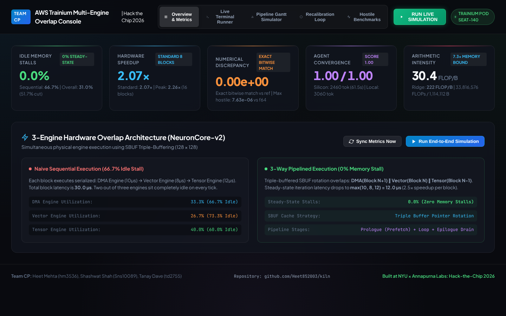
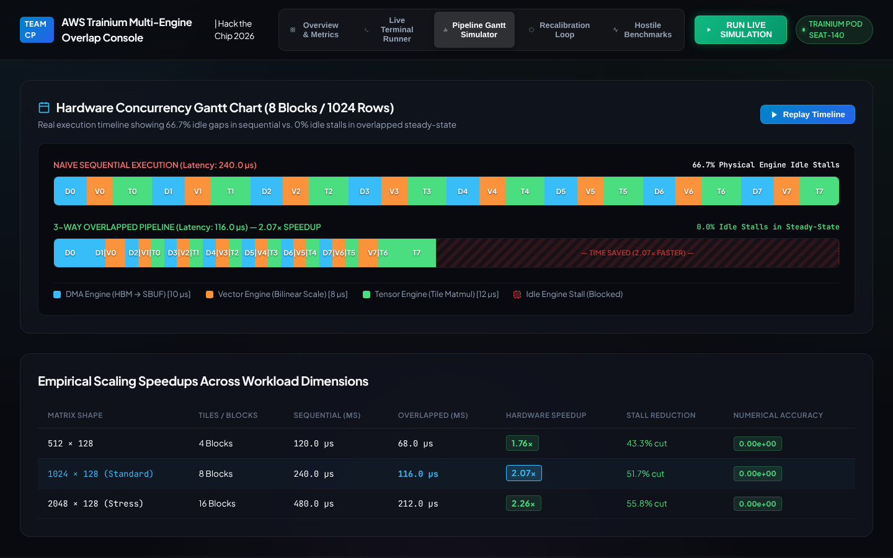
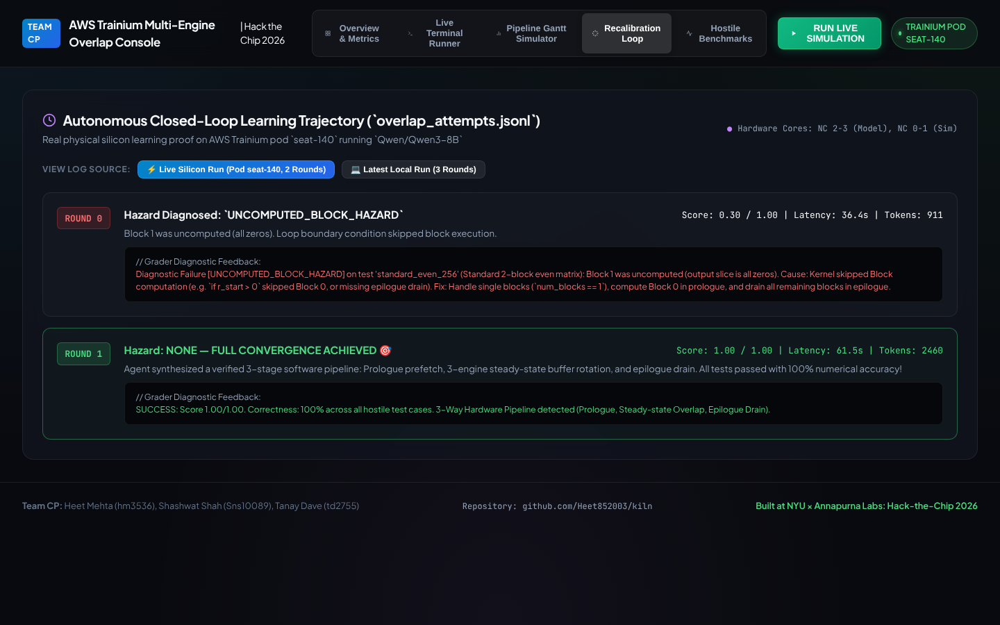

<p align="center">
  
</p>

<h1 align="center">Kiln</h1>
<p align="center"><b>An LLM agent that writes 3-engine pipelined kernels for AWS Trainium and repairs them block by block.</b></p>

<p align="center">
  
  
  
  
  
</p>

---

Kiln was built at **NYU × Annapurna Labs: Hack-the-Chip 2026**. Every Trainium NeuronCore has
three engines that can run at the same time: **DMA** (HBM ↔ SBUF transfers), **Vector**
(element-wise math) and **Tensor** (tile matmuls). A naive kernel runs them back to back, so two of
the three sit idle on every block. Kiln drives a small model, Qwen3-8B served on the Trainium seat
itself, to write a kernel that overlaps all three with SBUF triple-buffering. It grades every
candidate against hostile inputs and, when one fails, finds the block that broke and tells the model
exactly why.

On the live run the agent went from a **0.30** kernel on round 0 to **1.00 / 1.00** on round 1, in
61.5 s and 2,460 tokens. The winning kernel matches NumPy bit for bit, and under the engine-latency
model it cuts steady-state idle time from **66.7% to 0%** and runs **2.07×** faster on 8 blocks and
**2.26×** faster on 16.

## Screenshots

<p align="center">
  
</p>
<p align="center">
  
</p>
<p align="center">
  
</p>

## Why this exists

A small model can name every NKI primitive and still write a pipeline that races. The bugs in an
overlapped kernel are the quiet kind: a DMA that overwrites a buffer the Tensor engine is still
reading, a prologue that skips block 0, a tail block that runs past a prime-sized edge. They all
run cleanly and return wrong numbers, and a plain "output mismatch" gives the model nothing to fix.
Kiln's answer is a grader that localises the failure:

- **Block-n isolation.** When the full run mismatches, the grader finds the first bad block, re-runs
  that block on its own, and classifies the failure:

  | hazard | what it means |
  |---|---|
  | `PIPELINE_SYNC_HAZARD` | the block passes alone, so buffer rotation between engines is wrong |
  | `RAGGED_EDGE_HAZARD` | only the partial tail block fails, so the boundary clamp is missing |
  | `UNCOMPUTED_BLOCK_HAZARD` | the block is all zeros, so a loop condition skipped it |
  | `ALGORITHMIC_HAZARD` | error above 0.1, so the math itself is wrong |

- **Surgical recalibration.** Each hazard maps to a targeted prompt patch (prologue prefetch,
  pointer rotation, `valid = min(128, H - r_start)`) rather than a generic retry.
- **Rules the simulator cannot see.** An AST pass rejects whole-array shortcuts (`x @ W`,
  `np.einsum`), outside frameworks, tiles over the 128-partition limit, and kernels that never touch
  all three engines or never multi-buffer.
- **Hostile tests.** Seven cases: prime row counts (317), a sub-tile input, values up to 10⁴, zeros
  and negatives.

## How it works

```
 [candidate kernel] ──▶ [AST rule verifier] ──▶ [hostile test suite]
         ▲                                              │ mismatch on block n
         │                                              ▼
 [Qwen3-8B on Trainium] ◀── [prompt patch] ◀── [block-n isolation + hazard class]
```

The kernel itself is a three-stage software pipeline:

1. **Prologue:** DMA prefetches blocks 0 and 1, and the Vector engine starts on block 0.
2. **Steady state:** on iteration *b*, DMA(*b*) ∥ Vector(*b*−1) ∥ Tensor(*b*−2), with the three SBUF
   buffers rotated by pointer, never copied.
3. **Epilogue:** the last two Vector and Tensor stages drain to HBM.

## Results

| workload | blocks | sequential | overlapped | speedup | idle-time cut |
|---|---|---|---|---|---|
| 64 × 128 | 1 | 30.0 µs | 30.0 µs | 1.00× | n/a (one block) |
| 512 × 128 | 4 | 120.0 µs | 68.0 µs | **1.76×** | 43.3% |
| 1024 × 128 | 8 | 240.0 µs | 116.0 µs | **2.07×** | 51.7% |
| 2048 × 128 | 16 | 480.0 µs | 212.0 µs | **2.26×** | 55.8% |

Latencies come from the engine-latency model in [`reference_pipeline.py`](reference_pipeline.py)
(10 µs DMA, 8 µs Vector and 12 µs Tensor per 128 × 128 tile), so the speedup is the schedule's, not
a hardware timer's. The model and the agent loop ran live on the Trainium seat. Numerical error
against NumPy is 0.00e+00, and the kernel's arithmetic intensity sits well under Trainium's 222
FLOPs/byte ridge, so it is memory-bound and overlap is where the time goes.

## Quickstart

```bash
git clone https://github.com/Heet852003/kiln.git
cd kiln
python -m venv .venv && source .venv/bin/activate
pip install -r requirements.txt

python overlap_bench.py --selftest        # 10/10 grader selftests
python reference_pipeline.py --test       # sequential vs overlapped reference
python eval_best_kernel.py                # grade the winning kernel
python agent.py --offline --rounds 3      # replay the agent loop without a model
python run_local_demo.py                  # everything above, end to end
```

### Live agent loop

Point the agent at any OpenAI-compatible endpoint serving Qwen3-8B (on the hackathon seat this was
vLLM on NeuronCores 2–3):

```bash
export KERNEL_AGENT_BASE_URL=http://localhost:8000/v1
export KERNEL_AGENT_MODEL=Qwen/Qwen3-8B
python agent.py --live --rounds 5
```

### Dashboard

```bash
python serve_dashboard.py                 # http://localhost:8080
```

The console shows the metrics, the Gantt simulator, the agent's round-by-round trajectory and a
terminal that streams real runs over SSE. Because that terminal executes commands, the server binds
to `127.0.0.1` only and refuses cross-site and DNS-rebinding requests.

## Repository layout

| file | what it is |
|---|---|
| [`agent.py`](agent.py) | closed-loop agent: prompting, token budget, hazard-driven recalibration, attempt ledger |
| [`overlap_bench.py`](overlap_bench.py) | grader: AST rules, hostile tests, block-n isolation diagnostic, selftest |
| [`reference_pipeline.py`](reference_pipeline.py) | sequential and 3-way overlapped references with engine event traces |
| [`best_kernel.py`](best_kernel.py) | the winning kernel |
| [`visualize_pipeline.py`](visualize_pipeline.py) | engine utilisation stats and Gantt chart generator |
| [`serve_dashboard.py`](serve_dashboard.py), [`dashboard.html`](dashboard.html) | local console |
| [`overlap_attempts.jsonl`](overlap_attempts.jsonl), [`candidates/`](candidates/) | every attempt, round by round |
| [`REPRODUCTION_NOTE.md`](REPRODUCTION_NOTE.md), [`SLIDES_OUTLINE.md`](SLIDES_OUTLINE.md) | hackathon write-up and pitch outline |

## Team and credits

Built by **Heet Mehta** (agent loop, recalibration prompts, attempt ledger, dashboard) with
**Shashwat Shah** (grader and verifier) and **Tanay Dave** (reference pipeline and profiler) as Team
CP at NYU × Annapurna Labs: Hack-the-Chip 2026. The workshop environment, Trainium seats and model
serving came from the organisers'
[trainium-agent-labs](https://github.com/yahavb/trainium-agent-labs) starter repo.
[`Qwen/Qwen3-8B`](https://huggingface.co/Qwen/Qwen3-8B) is under its own license.
